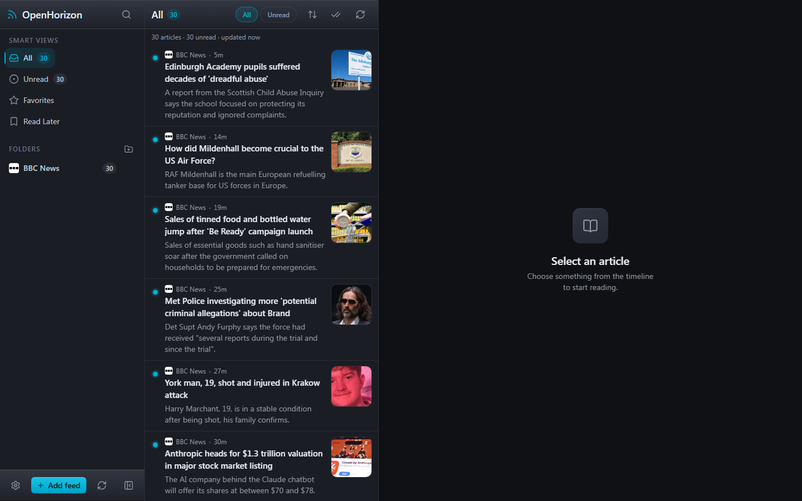
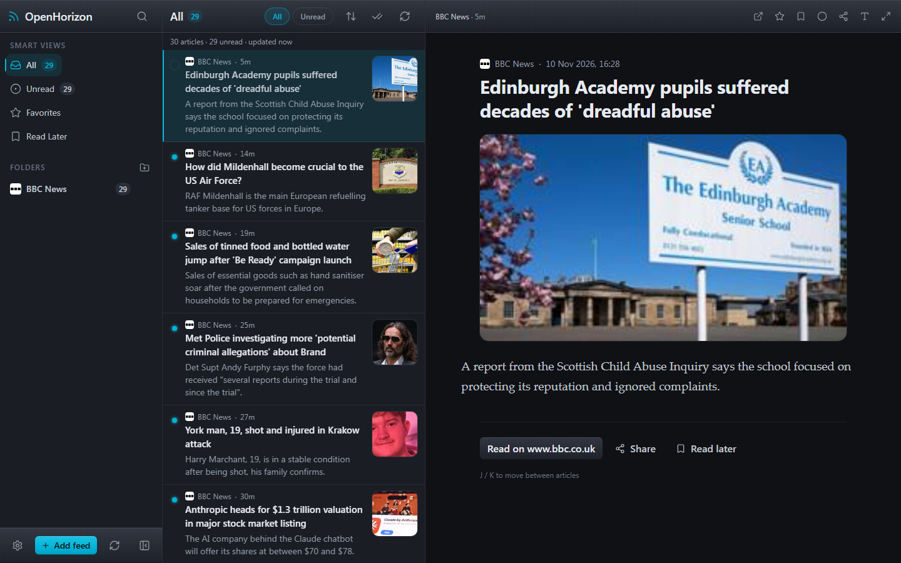

<h1 align="center">
  
  <br />
  OpenHorizon
</h1>

<p align="center">
  <em>A modern metallic-grey RSS reader PWA</em>
</p>

<p align="center">
  <a href="LICENSE"></a>
  
  
  
  
  
  
  <a href="https://github.com/axadream/OpenHorizon/actions/workflows/deploy.yml"></a>
</p>

<p align="center">
  <a href="https://axadream.github.io/OpenHorizon/"><strong>Open the live demo</strong></a>
</p>

---

OpenHorizon is a mobile-first, installable PWA RSS reader inspired by the free desktop app [Orizont RSS](https://grifnas.github.io/OrizontRSS/index.en.html) by Grigore Frișan. It is privacy-friendly by design: everything stays in your browser. There is no account and no server-side storage.

## Live demo and install

**Try it now at [axadream.github.io/OpenHorizon](https://axadream.github.io/OpenHorizon/).** Once the page is open, you can install OpenHorizon as an app on your phone or computer (see [Install on your phone](#install-on-your-phone)).

## Key features

- **Dark metallic grey aesthetic**: a `#0F1115` base with brushed-steel gradients, glass highlights and subtle micro-animations. Motion is reduced automatically when your system asks for it.
- **Responsive layout**: a three-pane view on desktop, a navigation rail on tablet, and a single-pane view with a bottom navigation bar on mobile.
- **Multiple feed formats**: RSS 2.0, Atom, RSS 1.0 and JSON Feed. Add a feed by direct URL, by pasting its XML, or by website auto-discovery.
- **Organisation**: OPML import and export, folders, favorites, an unread filter and Read Later.
- **Offline first**: articles are stored locally in IndexedDB (through Dexie), so you can read offline after your first visit.
- **Background sync**: refresh every 15 minutes, 30 minutes or 1 hour, or sync manually. Periodic Background Sync is used where the browser supports it. Favorite feeds can send system notifications.
- **Sharing**: the Web Share API, with a fallback sheet for X, WhatsApp, Telegram, Reddit, LinkedIn, Facebook, email and copy link.
- **Reader preferences**: text size, line height, serif or sans-serif font, column width, image display and fullscreen reading.
- **Keyboard navigation**: every common action has a shortcut (see [Keyboard shortcuts](#keyboard-shortcuts)).
- **Accessible**: landmarks, listbox semantics for the article list and visible focus rings.

## Screenshots

| Main window (3-pane) | Reader | Mobile view |
| :---: | :---: | :---: |
|  |  |  |

## Install on your phone

OpenHorizon runs in any modern browser, and you can add it to your home screen like a native app.

- **iOS (Safari)**: open the [live demo](https://axadream.github.io/OpenHorizon/), tap **Share**, choose **Add to Home Screen**, then tap **Add**.
- **Android (Chrome, Edge or Brave)**: tap the install banner when it appears, or open the **⋮** menu and choose **Install app** or **Add to Home screen**.
- **Desktop (Chrome or Edge)**: click the install icon in the address bar.

## Feeds and CORS

Browsers block most feed requests made across websites (CORS), so OpenHorizon has to fetch feeds through a route that allows them. It tries each route in order and stops at the first one that works:

1. a direct fetch from your browser,
2. your own proxy, set with `VITE_CORS_PROXY`,
3. the built-in same-origin `/api/proxy`, when the app is hosted with serverless functions,
4. public proxies, in this order: jina reader (r.jina.ai), allorigins (JSON and raw), corsproxy, codetabs and rss2json (last, feeds only).

Routes are hedged: when a route has not answered after 2.5 seconds the next one starts too, and the first success wins.

The GitHub Pages demo has no server, so some feeds may fail there. For reliable results, host your own proxy. The repository includes these options:

- **Cloudflare Worker (free, recommended for the GitHub Pages demo)**: run `npx wrangler login` once, then `npm run worker:deploy`. It deploys `worker/index.mjs` and prints a `https://openhorizon-proxy.<account>.workers.dev` URL.
- **Standalone Node server**: run `npm run proxy` (listens on port 8787 by default).
- **Cloudflare Pages**: deploy `functions/api/proxy.js` with your site.
- **Vercel**: deploy `api/proxy.js` with your site.

Then point the app at your proxy by setting the build-time variable:

```sh
VITE_CORS_PROXY=https://openhorizon-proxy.<account>.workers.dev/api/proxy?url={url}
```

For a GitHub Pages build, add the same value as a repository variable named `VITE_CORS_PROXY` under **Settings → Secrets and variables → Actions → Variables**. The deploy workflow passes it to the build. The `{url}` placeholder is replaced with the encoded feed address.

## Keyboard shortcuts

| Keys | Action |
| --- | --- |
| `J` or `↓` | Next article |
| `K` or `↑` | Previous article |
| `Enter` or `O` | Open selected article (mobile: reader) |
| `←` / `→` | Move focus between panes |
| `M` | Toggle read |
| `L` | Toggle Read Later |
| `F` | Toggle favorite |
| `S` | Share article |
| `V` | Open original in a new tab |
| `R` | Refresh all feeds |
| `Shift+R` | Refresh current feed |
| `A` | Add feed |
| `Shift+A` | Mark all read in this view |
| `Shift+F` | Toggle reader fullscreen |
| `/` | Search feeds |
| `1` `2` `3` `4` | Smart views: All, Unread, Favorites, Read Later |
| `,` | Settings |
| `?` | Keyboard shortcuts (Settings, App section) |
| `Esc` | Close, exit fullscreen, go back a pane, clear search |

Shortcuts are ignored while you type in a text field or while a dialog is open. `Esc` always works.

## Developer setup

**Requirements:** Node.js 22 or newer and npm.

```sh
npm install
npm run dev            # development server at http://localhost:5173
```

| Command | Purpose |
| --- | --- |
| `npm run dev` | Start the Vite development server |
| `npm test` | Run the Vitest test suite |
| `npm run typecheck` | Type-check the application code |
| `npm run build` | Type-check and build for production into `dist/` |
| `npm run preview` | Serve the production build locally, including `/api/proxy` |
| `npm run build:pages` | Build for GitHub Pages with base path `/OpenHorizon/` |
| `npm run deploy` | Manual fallback: build for Pages and publish `dist/` to the `gh-pages` branch |
| `npm run proxy` | Run the standalone CORS proxy on port 8787 |

Copy `.env.example` to `.env.local` to configure the app. The variables are:

- `VITE_CORS_PROXY`: your own feed proxy (see [Feeds and CORS](#feeds-and-cors)).
- `VITE_DISABLE_LOCAL_PROXY`: set to `1` on static hosts without functions. `npm run build:pages` sets it for you.
- `VITE_BASE`: the public base path, for example `/OpenHorizon/` for a GitHub Pages project site.

**Automatic deployment.** The workflow in `.github/workflows/deploy.yml` runs on every push to `main`. It installs dependencies with `npm ci`, runs the type-check and tests, builds with `npm run build:pages`, and publishes `dist/` to GitHub Pages. Enable **Settings → Pages → Build and deployment → GitHub Actions** once for the repository.

## Tech stack

- **Language and UI**: TypeScript, React 19, Lucide icons, Tailwind CSS v4
- **Build**: Vite, `vite-plugin-pwa`
- **Offline and storage**: Workbox service worker, Dexie (IndexedDB), Zustand for UI state
- **Content safety**: DOMPurify for article HTML
- **Testing and quality**: Vitest, jsdom, oxlint

## Project structure

```text
OpenHorizon/
├── public/              static assets, including icons/icon.svg
├── src/
│   ├── app/             application shell and providers
│   ├── components/      reusable UI components
│   ├── features/        feature modules (feeds, articles, sync, sharing, settings)
│   ├── lib/             shared utilities (feed parsing, toast, helpers)
│   ├── db/              Dexie database schema
│   ├── store/           Zustand UI state
│   ├── hooks/           shared hooks (keyboard shortcuts, sync)
│   └── sw.ts            service worker (offline cache and background sync)
├── server/              standalone proxy and shared proxy handler
├── functions/           Cloudflare Pages function (/api/proxy)
├── api/                 Vercel function (/api/proxy)
├── docs/                design and architecture documents
└── .github/workflows/   GitHub Pages deployment
```

## Credits and acknowledgements

OpenHorizon exists because of **Orizont RSS**, a free desktop RSS reader created by **Grigore Frișan**. Its clear layout, reading experience and philosophy of simple, personal feed reading inspired this project. Thank you for making and sharing it.

- Original project: [Orizont RSS](https://grifnas.github.io/OrizontRSS/index.en.html) by Grigore Frișan

OpenHorizon also builds on excellent open-source work:

- [Lucide](https://lucide.dev/) for icons
- [Dexie](https://dexie.org/) for IndexedDB storage
- [Workbox](https://developer.chrome.com/docs/workbox/) for the service worker
- [Tailwind CSS](https://tailwindcss.com/) for styling

## License

OpenHorizon is free software, licensed under the **GNU General Public License v3.0 or later (GPL-3.0-or-later)**. See the [LICENSE](LICENSE) file for the full text.
